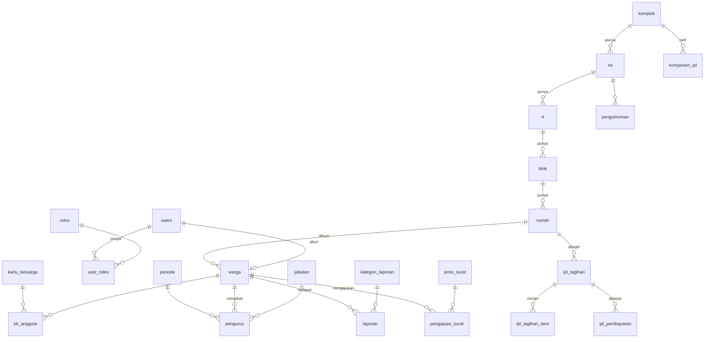

# Skema Database Rewang

File: [`database/schema.sql`](../database/schema.sql) (struktur) dan [`database/seed.sql`](../database/seed.sql) (role, permission, master data).
Target MySQL 5.7+ / MariaDB 10.3+, InnoDB, `utf8mb4`. Total **53 tabel** dalam 11 kelompok.

## Prinsip desain

1. **Hierarki unit lingkungan**: `komplek → rw → rt → blok → rumah`. Semua data operasional (laporan, surat, pengumuman, IPL) menempel ke unit ini, jadi satu instalasi bisa melayani banyak komplek/RW.
2. **Satu tabel login** (`users`), dengan password hanya disimpan sebagai `password_hash`. Data kependudukan ada di `warga`, terhubung lewat `warga.user_id`. Pengurus RT/RW adalah warga biasa yang punya baris di `pengurus` + role di `user_roles`.
3. **Role berskala wilayah**: `user_roles` menyimpan `komplek_id / rw_id / rt_id`. Contoh: Pak A = `pengurus_rt` untuk RT 003, sekaligus `warga`.
4. **RW dan RT tidak dibuat tabel kembar**: `periode`, `galeri`, `pengumuman` memakai kolom `level` (`rw`/`rt`).
5. **Satu sumber tarif IPL**: `komponen_ipl` per komplek, dengan metode `flat`, `per_m2_tanah`, `per_m2_bangunan`, atau `per_tipe_rumah`. Tagihan menyimpan snapshot rincian di `ipl_tagihan_item`, jadi perubahan tarif tidak mengubah tagihan lama.
6. **Workflow dengan jejak**: setiap perubahan status (registrasi, laporan, surat, IPL, perubahan profil) dicatat di `status_log` → dipakai untuk timeline "Histori Transaksi" di mobile.
7. **Tidak ada rahasia di database**: password SMTP/API key ada di `api/config.php`, bukan tabel.

## Diagram relasi inti

## Kelompok tabel

| # | Kelompok | Tabel |
|---|---|---|
| 1 | Wilayah administratif | `provinsi`, `kota_kab`, `kecamatan`, `desa_kel` |
| 2 | Unit lingkungan | `tipe_property`, `komplek`, `rw`, `rt`, `blok`, `tipe_rumah`, `rumah` |
| 3 | Login & akses | `users`, `roles`, `permissions`, `role_permissions`, `user_roles`, `api_tokens`, `password_resets` |
| 4 | Master warga | `pekerjaan`, `status_hubungan` |
| 5 | Warga & KK | `warga`, `kartu_keluarga`, `kk_anggota`, `registrasi`, `perubahan_profil` |
| 6 | Organisasi | `seksi`, `jabatan`, `periode`, `pengurus`, `galeri`, `galeri_foto` |
| 7 | Laporan warga | `kategori_laporan`, `laporan`, `laporan_lampiran` |
| 8 | Surat | `jenis_surat`, `jenis_surat_syarat`, `pengajuan_surat`, `pengajuan_surat_lampiran` |
| 9 | IPL | `komponen_ipl`, `komponen_ipl_tarif`, `ipl_tagihan`, `ipl_tagihan_item`, `ipl_pembayaran` |
| 10 | Konten | `kategori_pengumuman`, `pengumuman`, `banner`, `faq_kategori`, `faq`, `app_rilis`, `pengaturan` |
| 11 | Notifikasi & log | `notifikasi`, `status_log`, `audit_log` |

## Role & permission (seed)

| Role | Cakupan | Permission |
|---|---|---|
| `super_admin` | Seluruh platform | Semua (25) |
| `admin_rw` | Satu RW / komplek | Semua kecuali pengaturan platform & aksi khusus warga (21) |
| `pengurus_rw` | Satu RW | Lihat warga, verifikasi, proses laporan & surat, verifikasi IPL, pengumuman, organisasi (15) |
| `pengurus_rt` | Satu RT | Seperti pengurus RW + kelola data warga, tanpa verifikasi IPL (14) |
| `seksi` | Satu seksi di RW | Lihat & proses laporan yang ditugaskan (4) |
| `warga` | Dirinya sendiri | Buat laporan, ajukan surat, bayar IPL, baca pengumuman (4) |

Aturan cakupan (RT hanya melihat warganya sendiri, dsb.) ditegakkan di API PHP, berdasarkan `user_roles.rw_id / rt_id`.

## Alur status

| Proses | Status |
|---|---|
| Registrasi akun | `baru → disetujui / ditolak` (users.status `pending → active`) |
| Perubahan profil | `menunggu → disetujui / ditolak` (data dari JSON `data_baru` disalin ke `warga`) |
| Laporan | `baru → diproses → selesai` / `ditolak` |
| Pengajuan surat | `baru → diproses → selesai` / `ditolak` |
| Tagihan IPL | `belum_bayar → menunggu_verifikasi → lunas` (atau `sebagian`, `batal`) |
| Pembayaran IPL | `menunggu → diterima / ditolak` |

## Pemetaan dari sistem lama (GeneXus)

| Lama | Baru | Catatan |
|---|---|---|
| Provinsi, KotaKab, Kecamatan, DesaKel | `provinsi`, `kota_kab`, `kecamatan`, `desa_kel` | Sama |
| NamaKomplek, TipeProperty | `komplek`, `tipe_property` | Tarif IPL dipindah ke `komponen_ipl` |
| MasterRW, MasterRT, Blok | `rw`, `rt`, `blok` | |
| Rumah | `rumah` | Nama RW/RT/Blok tidak lagi disalin sebagai teks |
| TipeRumah (+ IuranBulanan) | `tipe_rumah` + `komponen_ipl_tarif` | |
| KomponenIPL | `komponen_ipl` | Sekarang benar-benar dipakai untuk hitung tagihan |
| IuranIPLWarga | `ipl_tagihan` + `ipl_tagihan_item` + `ipl_pembayaran` | Tagihan dan pembayaran dipisah; bisa cicil |
| Akun | `users` + `registrasi` | Password tidak lagi plain text |
| GAM Users/Roles | `users`, `roles`, `user_roles`, `permissions` | |
| Warga | `warga` | Nama depan/belakang dilebur jadi `nama_lengkap` + `nama_panggilan` |
| wargatemp | `perubahan_profil` | Perubahan disimpan sebagai JSON |
| DataKK | `kartu_keluarga` + `kk_anggota` | Anggota KK sekarang eksplisit |
| StatusHub, Pekerjaan | `status_hubungan`, `pekerjaan` | |
| Department | `seksi` | Per RW |
| Jabatan | `jabatan` | `level` rw/rt |
| Periode, PeriodeRT | `periode` | Digabung, kolom `level` |
| Pengurus, PengurusRT | `pengurus` | Tidak lagi menyalin NIK/nama/password warga |
| ProfileRW, ProfileRT | kolom `sambutan`, `foto_path`, `sk_path` di `periode` | |
| GalleryPhoto, GalleryPhotoRT | `galeri` + `galeri_foto` | Satu album bisa banyak foto |
| KategoriKeluhan | `kategori_laporan` | |
| LaporanWarga (+ Photo1..3) | `laporan` + `laporan_lampiran` | Foto tidak dibatasi 3, ada foto penyelesaian |
| JenisSurat, DocSyarat | `jenis_surat`, `jenis_surat_syarat` | |
| PengajuanSurat | `pengajuan_surat` + `pengajuan_surat_lampiran` | |
| BeritaKategori, Pengumuman | `kategori_pengumuman`, `pengumuman` | Tiga menu pengumuman → satu tabel (`dari_level` + `target`) |
| Banner | `banner` | |
| KategoriFAQ, FAQRewang | `faq_kategori`, `faq` | |
| AboutApps | `app_rilis` + `pengaturan` | |
| Smtp, URLAplikasi | `api/config.php` + `pengaturan` | Rahasia keluar dari database |

## Belum dicakup (tahap berikutnya)

- Forum jual beli (e-commerce antar warga).
- Payment gateway / virtual account (kolom `metode` & `referensi` di `ipl_pembayaran` sudah disiapkan).
- Fasilitas umum & booking.
- Super admin pertama: nanti dibuat lewat script CLI (`php api/cli/create-admin.php`), bukan lewat seed, supaya tidak ada password bawaan.
